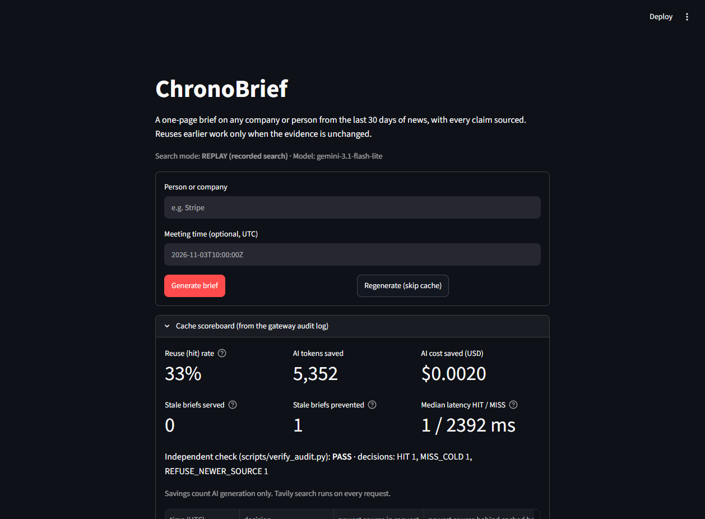
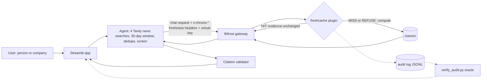

# ChronoBrief

**Evidence-aware caching for AI meeting briefs.** Generate once, reuse when the evidence is unchanged, regenerate when the retrieved facts move.

ChronoBrief writes a one-page pre-meeting brief on any company or person from the last 30 days of news, with every claim linked to its source. Underneath, a custom plugin for the open-source [Bifrost](https://github.com/maximhq/bifrost) AI gateway decides on every request whether a stored brief is still valid. It reuses the brief when no newer source exists, and refuses it the moment a newer one appears.

Built for the **Geek Room Global AI Hackathon**, combining:
- **Bifrost track, problem 04:** *a feature the open-source gateway is missing.* We built a freshness-aware cache plugin (`freshcache.so`).
- **Tavily track, problem 02:** *pre-meeting briefing agent.* We built a 30-day sourced brief built on Tavily news search.



> **Live demo:** _link to be added_ · **Demo video:** _link to be added_

---

## The problem

Caching AI answers saves real money, but a normal cache doesn't know when its answer has gone out of date:

| Cache setting | Savings | Risk |
|---|---|---|
| Short memory (a TTL of a few minutes) | Small. Most repeat requests come more than 5 minutes apart | Fresh, but recomputes when nothing changed |
| Long memory (for example 24 hours) | Large | Serves yesterday's brief after breaking news |
| **ChronoBrief (`freshcache`)** | Large while the evidence is unchanged | **Refuses the stored brief as soon as a newer source is retrieved** |

ChronoBrief separates **when a brief was generated** from **how fresh the evidence behind it is**, and only the second decides reuse.

## How it works



1. **Retrieve.** The agent runs four Tavily news searches (general, people, launches, deals) over the last 30 days, merges and deduplicates them, drops anything outside the window, and keeps the 25 newest.
2. **Fingerprint.** From the sources the model will actually see, it computes the newest publication date, how many sources share it, the dated and undated counts, and a hash of every (URL, date, headline). These travel to the gateway as `x-chrono-*` headers.
3. **Decide (the plugin).** `freshcache` makes exactly one decision per request, with no network calls of its own: **serve or recompute.**
4. **Validate.** Every claim in the brief must cite a retrieved source, every number must appear in the cited text, and every cited source must sit inside the window. Failing claims are removed, never rewritten.

### Plugin decisions

| Decision | When | Result |
|---|---|---|
| `HIT` | Stored brief exists and no source in the request is newer | Served from cache, with no model cost |
| `MISS_COLD` | No stored brief for this tenant + subject + prompt version | Generated and stored |
| `REFUSE_NEWER_SOURCE` | A source is newer than the stored brief's newest | Regenerated: **the stale brief is never served** |
| `REFUSE_SET_CHANGED` | Same dates, but an article was added, removed or its headline corrected | Regenerated |
| `REFUSE_EXPIRED` | Stored brief older than the hard TTL (24 h) | Regenerated |
| `REFUSE_NO_FINGERPRINT` | Evidence incomplete or undated (for example, a search failed) | Generated but **not stored** |
| `REFUSE_FUTURE_DATE` | A source claims a date in the future | Not trusted, not stored |
| `REFUSE_NO_TENANT` | No virtual key | Caching off (fail closed) |
| `BYPASS_REFRESH` | User asked to skip the cache | Regenerated and replaces the stored brief |

The cache key is a SHA-256 of tenant, subject, intent, window, prompt version and model, where `tenant` is a hash of the Bifrost virtual key. Two teams never share entries, and any prompt change invalidates every old entry.

## How we use Bifrost

- **A native Go plugin** (`freshcache.so`), loaded by Bifrost `transports/v2.4.0` from `gateway/config.json`. It uses three Bifrost hooks:
  - `HTTPTransportPreHook` reads the `x-chrono-*` freshness headers.
  - `PreLLMHook` makes the serve-or-recompute decision. On a `HIT` it short-circuits, so the model is never called.
  - `PostLLMHook` stores fresh answers and writes one audit line per decision.
- **Virtual keys (Bifrost governance).** Each team gets its own virtual key (`x-bf-vk`). The plugin hashes that key into the tenant id, so one team's cached brief is never served to another. A request without a key is not cached.
- **Provider routing.** The app never talks to Gemini directly: every model call goes through Bifrost, which holds the provider key.

## How we use Tavily

- **News search, last 30 days.** Each brief runs four Tavily `/search` calls (general, people, launches, deals) with `topic="news"`, a `start_date` 30 days back, a trusted-publisher allowlist and a domain blocklist (`chronobrief/retrieval.py`).
- **Tavily's dates drive the cache.** Each result's published date and URL go into the evidence fingerprint. That fingerprint is what lets the plugin tell "same evidence" from "a newer article exists".
- **Every claim is cited.** Brief claims must cite a Tavily result inside the window. Claims that cite nothing are dropped.
- **Replay mode** uses a real recorded Tavily response (`fixtures/tavily/`), so the demo works offline and spends no credits.

## Proof

All numbers come from runs against the real gateway (Bifrost `transports/v2.4.0` + `freshcache.so`, model `gemini-3.1-flash-lite`). Raw output is in [`docs/evidence/`](docs/evidence).

**End to end, with the independent audit oracle** ([`e2e-cache-20261107T170601Z.txt`](docs/evidence/e2e-cache-20261107T170601Z.txt), commit `20107f1`, the recorded demo take). `scripts/e2e_cache.py` sends a first request, the same request again, then injects a newer article; `scripts/verify_audit.py` then re-checks only that run's audit lines from their dates, without trusting the plugin's own label:
```
PASS  1 first request      MISS_COLD              9 claims, 1 call(s)
PASS  2 same evidence      HIT                    9 claims, 1 call(s)
PASS  3 newer article      REFUSE_NEWER_SOURCE    10 claims, 1 call(s)

audit oracle (scripts/verify_audit.py, 3 audit lines from this run only):
lookups 3  hits 1  hit rate 33.3%
stale serves 0  (stale answers prevented: 1)
saved (LLM only): 5496 tokens  $0.0016
```

**Plugin overhead** (25 live runs in Docker, raw data in [`live-overhead-25runs.txt`](docs/evidence/live-overhead-25runs.txt)): HIT median **0.95 ms**; MISS median **1.06 ms**, before the model call itself.

**Plugin overhead in the recorded take:** the same script, run on the cloud VM during the recorded demo take (native build, no Docker), measured HIT median **0.23 ms** and MISS median **0.40 ms** ([`recorded-take-20107f1/demo.cast`](docs/evidence/recorded-take-20107f1/demo.cast)). These are the figures in the video and the deck. For comparison, one uncached model call through the gateway in that take took 1.40 s.

**Gateway negative proofs** ([`gateway-negative-tests.txt`](docs/evidence/gateway-negative-tests.txt)): no fingerprint, future-dated source, streaming, refresh, missing virtual key, **tenant isolation** (Team Alpha's HIT is Team Beta's MISS), changed source set. 7 of 7 pass.

**Tests:** 146 Python tests (93% coverage of `chronobrief/`), including 36 Python-vs-TypeScript fingerprint parity cases, and 36 Go test functions plus a header fuzz test, including a 300,000-iteration property test that no generated case ever serves a stale entry. `ruff`, `mypy --strict` and a custom invariant checker are all clean.

## Three-minute demo

1. Type **Stripe** → **Generate brief** → banner **MISS**. The brief has sections for news, executive moves, product launches and open questions, with numbered sources.
2. **Generate brief** again → **HIT**, about 1 ms of gateway overhead, tokens saved shown.
3. **Demo controls → Simulate breaking news.** This adds one article clearly badged **SIMULATED**, dated now.
4. **Generate brief** → **REFUSED STALE**. The banner shows why, and the new brief can cite the simulated source.
5. Open the **Cache scoreboard**: stale briefs served **0**, prevented **1**, independent check **PASS**.
6. **Reset demo.**

Replay mode uses a real recorded Tavily search (40 results, captured 1 Nov 2026), so the demo is deterministic and spends no search credits. Live mode searches any subject.

## Run it locally

Requirements: Docker Desktop (on Windows, with WSL2), Git, Python 3.11+, a Gemini API key, and a Tavily API key (live mode only).

```bash
git clone https://github.com/PankajDavid/chronobrief.git && cd chronobrief
python -m venv .venv && source .venv/bin/activate     # Windows: .venv\Scripts\activate
pip install -e ".[dev]"
cp .env.example .env                                  # Windows: copy .env.example .env
python -c "import secrets; print(secrets.token_hex(16))"   # run twice, for the two virtual keys
```

Edit `.env`: set `GEMINI_API_KEY`, `CHRONO_VK_ALPHA=sk-bf-alpha-<hex>`, `CHRONO_VK_BETA=sk-bf-beta-<hex>`, and `TAVILY_API_KEY` for live mode. The gateway **refuses to start** with missing or placeholder secrets.

```bash
docker compose up -d --build          # Bifrost + freshcache on 127.0.0.1:8080 (first build: 5-10 min)
python -m pytest -q                   # 146 passed
streamlit run app/streamlit_app.py    # the dashboard
python scripts/e2e_cache.py           # MISS -> HIT -> REFUSE proof against your gateway
python -m chronobrief "Stripe"        # the same brief in the terminal
```

### Configuration

| Variable | Default | Meaning |
|---|---|---|
| `CHRONO_TAVILY_MODE` | `replay` | `replay` reads `fixtures/tavily/`; `live` calls Tavily |
| `CHRONO_MODEL` | `gemini-3.1-flash-lite` | Model name as Bifrost lists it |
| `BIFROST_URL` | `http://localhost:8080` | Where the app reaches the gateway |
| `CHRONO_VK_ALPHA` / `CHRONO_VK_BETA` | none (required) | Bifrost virtual keys, one per tenant |
| `CHRONO_VK` | `CHRONO_VK_ALPHA` | Which virtual key the app sends |
| `CHRONO_AUDIT_LOG` | `data/audit/freshcache.jsonl` | Plugin audit log read by the scoreboard |
| `CHRONO_WINDOW_DAYS` | `30` | News window |

## Security and honest limits

The full audit is in [`docs/SECURITY_AUDIT.md`](docs/SECURITY_AUDIT.md). In short:
- **No secrets in the repo or its history** (all commits scanned); no known vulnerabilities in the locked dependencies.
- The gateway listens on `127.0.0.1` only, runs as a non-root user, requires a virtual key, and refuses to start without real secrets.
- Article text is treated as untrusted. Instruction-like sources are screened out before the model sees them, source text is fenced, and model output is escaped before it's rendered.

Limits we state up front:
- **Header trust.** The plugin trusts the freshness headers from its caller. Anyone holding a valid virtual key could claim old dates and receive a stale brief. That's acceptable here because only our own app can reach the gateway. The hardening step is to sign the headers with a shared secret.
- **Single instance, in memory.** The cache and its request tracking live in one gateway process and reset on restart.
- **Exact keys.** Requests match by normalised subject, not by meaning ("Stripe" and "Stripe Inc" are different entries).
- **Search coverage.** If Tavily never returns a story, ChronoBrief can't know about it. "Fresh" means fresh relative to the retrieved evidence.
- **Savings count AI generation only.** Tavily search runs on every request, because the dates it returns are what make the decision possible.

## Repository map

| Path | What |
|---|---|
| `gateway/plugins/freshcache/` | Go plugin: `internal/decide` (the pure decision), `headers`, `key`, `store` (bounded LRU), `audit` |
| `Dockerfile`, `docker-compose.yml`, `gateway/` | Bifrost v2.4.0 (pinned by commit) + plugin, built with the same Go toolchain |
| `chronobrief/` | Python agent: `retrieval`, `fingerprint`, `prompt`, `brief` (schema + validator), `gateway` (client), `pipeline`, `metrics`, `ui` |
| `app/streamlit_app.py` | Dashboard |
| `scripts/` | `e2e_cache.py`, `verify_audit.py` (oracle), `tavily_probe.py`, `inject_article.py` (demo), `check_invariants.py` |
| `docs/` | Architecture, cache spec, decisions (ADRs), Bifrost recon, Tavily probe, security audit, evidence |

## Team

- **Swarit** ([@swaritbkp](https://github.com/swaritbkp)): gateway track, covering Bifrost recon, the `freshcache` plugin, the Docker build and the gateway proofs.
- **Pankaj David** ([@PankajDavid](https://github.com/PankajDavid)): agent and UI track, covering Tavily retrieval, the brief and citation validator, the gateway client, the dashboard, demo tooling and the security audit.
