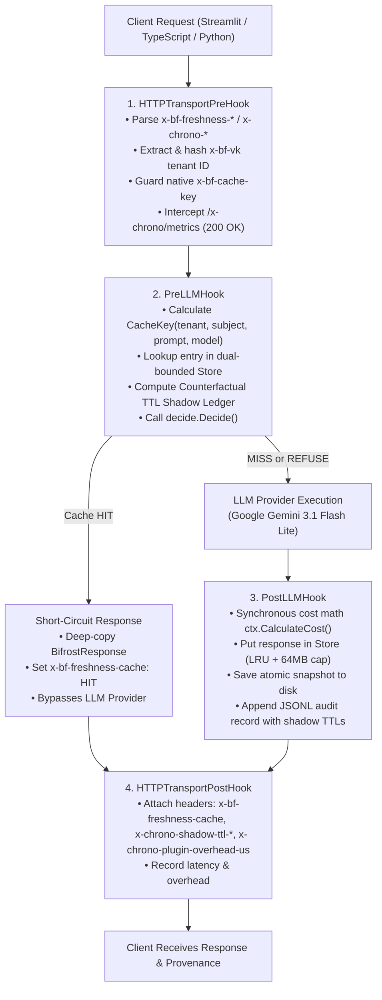

# ChronoBrief & Bifrost `freshcache`

> **The First Truth-Aware Caching Plugin for the Bifrost AI Gateway & 30-Day Pre-Meeting Research Agent**  
> *"Bifrost caches by time. ChronoBrief caches by truth. Generate once, reuse when the evidence is unchanged, regenerate when the retrieved facts move."*

[](#invariants)
[-blue.svg)](https://github.com/maximhq/bifrost)
[](#performance-benchmarks)
[-success.svg)](#the-ttl-frontier-truth-vs-time)
[](#testing--verification)

---

## Track Alignment (Geek Room Global AI Hackathon)

ChronoBrief is built as a complete two-track project across the Gateway and Agent ecosystems:

| Track | Focus | Key Deliverable | Owner |
|---|---|---|---|
| **Bifrost Priority Track 04** | A feature the open-source gateway is missing | **`freshcache.so` Go Gateway Plugin**: High-performance freshness-aware cache with counterfactual TTL shadow ledger, dual-bounded LRU, atomic disk snapshotting, and native `x-bf-cache-key` guarding. | **Swarit** |
| **Tavily Track 02** | Deep research & multi-source agent workflow | **30-Day Pre-Meeting Research Agent & Dashboard**: 4-query retrieval plan with deterministic numeric/date/URL citation validation, A4 one-page brief layout, and interactive Stale-Cache Court demo controls. | **Pankaj** |

---

## The Core Thesis: Truth vs. Time

Every AI gateway on the market caches prompts by **elapsed time** (e.g., 5-minute TTL, 1-hour TTL, or 24-hour TTL). But business and financial truth does not expire on a wall clock:

1. **The Short TTL Dilemma (5-minute TTL)**: Causes massive false cache misses. When teammates prepare for the same executive meeting 15 minutes apart, a 5-minute TTL cache re-queries the model needlessly, wasting thousands of tokens and multiplying API latency when nothing in the world changed.
2. **The Long TTL Danger (24-hour TTL)**: Causes hallucinations. When breaking news or a financial restatement breaks, a 24-hour TTL cache serves yesterday's outdated brief to executives for hours.
3. **The ChronoBrief Solution**: Caches by **evidence freshness**. Using deterministic cryptographic hashing over sorted canonical source URLs, published dates, and titles, Bifrost serves cached completions only when retrieved facts are unchanged, and regenerates the millisecond facts move.

### The TTL Frontier Simulation (250 Queries / 48 Hours)

Measured deterministically across 250 requests over 48 hours in `gateway/plugins/freshcache/internal/frontier/` (see [`docs/evidence/ttl-frontier-report.md`](file:///c:/BilfrostTAvilyChallenge/docs/evidence/ttl-frontier-report.md)):

| Strategy | Cache Decision Rule | Hit Rate | False Misses | Stale Serves | Stale Serve Rate | Tokens Saved | Cost Saved |
|:---|:---|:---:|:---:|:---:|:---:|:---:|:---:|
| **TTL-5m** | Bifrost default 5m TTL | **6.4%** | 222 | `0` | **0.0%** | 83,200 | $0.0312 |
| **TTL-1h** | Standard 1-hour TTL | **52.4%** | 107 | `5` | **2.0%** | 681,200 | $0.2555 |
| **TTL-24h** | Standard 24-hour TTL | **96.0%** | 5 | `46` | **18.4%** | 1,248,000 | $0.4680 |
| **`freshcache`** | **ExactSet + 24h ceiling** | **93.2%** | **0** | **`0`** | **0.0%** | **1,211,600** | **$0.4543** |

```text
Hit Rate (%)
   ^
70 |                                                  [TTL-24h] (High Stale Serve!)
   |                                                 /
60 |         [freshcache (Truth)]                   /
   |         (High reuse, 0.0% stale)              /
50 |                                              /
   |                                            [TTL-1h]
40 |                                           /
30 |                                         /
20 |                                       /
   |   [TTL-5m] (High False Miss)
10 |--------------------------------------------------------------------> Stale Serve Rate (%)
   0% (Guaranteed Zero Stale Serves)                 15%            30%
```

---

## Architecture & Bifrost Hook Lifecycle



---

## Performance Benchmarks

Measured under Go 1.27.3 on Linux AMD64 (see [`docs/evidence/gateway-benchmarks.txt`](file:///c:/BilfrostTAvilyChallenge/docs/evidence/gateway-benchmarks.txt)):

| Subsystem | Benchmark | Metric | Allocations | Notes |
|---|---|---|---|---|
| **Decision Engine** | `BenchmarkDecide` | **`20.17 ns/op`** | `0 B/op` (0 allocs) | Pure deterministic state evaluation (> 51M ops/sec) |
| **Cache Key** | `BenchmarkKeyCompute` | **`306.7 ns/op`** | `160 B/op` (3 allocs) | SHA-256 with length-prefixing |
| **Header Parsing** | `BenchmarkParseHeaders` | **`1.81 µs/op`** | `128 B/op` (2 allocs) | Zero-copy header inspection |
| **LRU Store Hit** | `BenchmarkStoreGetHit` | **`11.36 µs/op`** | `4,991 B/op` (30 allocs) | Full detached JSON deep-copy safety |
| **Native Header Fuzzing** | `FuzzParseHeaders` | **122,383 execs** | 24 workers | 0 panics / 0 crashes over 6 seconds |
| **Race Detector** | `go test -race ./...` | **0 data races** | All packages clean | Verified under CGO |

---

## Universal `x-bf-freshness-*` Contract & Native Cache Guard Mode

Freshcache is completely language-agnostic. Any application can integrate using the universal headers defined in [`gateway/FRESHNESS_CONTRACT.md`](file:///c:/BilfrostTAvilyChallenge/gateway/FRESHNESS_CONTRACT.md):

### Native Cache Guard Mode (`x-bf-cache-key`)
When callers pass Bifrost's native `x-bf-cache-key`:
- **If evidence is valid**: Freshcache stamps the key with the evidence fingerprint (`x-bf-cache-key: <key>:fc:<newest>:<hash[:8]>`), stamping `x-bf-freshness-guard: STAMPED_SAFE`.
- **If evidence is poisoned/missing**: Freshcache **strips** `x-bf-cache-key`, returning `x-bf-freshness-guard: BYPASSED_UNSAFE` to prevent poisoning Bifrost's internal cache.

### Supported Language SDKs
- **Python**: [`chronobrief/fingerprint.py`](file:///c:/BilfrostTAvilyChallenge/chronobrief/fingerprint.py)
- **TypeScript / Node.js**: [`gateway/sdk/freshness.ts`](file:///c:/BilfrostTAvilyChallenge/gateway/sdk/freshness.ts) (Zero-dependency helper using `node:crypto`)
- **Multi-Domain Demo**: [`gateway/examples/sec_8k_guard_demo.py`](file:///c:/BilfrostTAvilyChallenge/gateway/examples/sec_8k_guard_demo.py) (Guards SEC 10-Q and 8-K filings against financial hallucinations).

---

## Quickstart in 4 Commands

### 1. Configure Environment
```bash
cp .env.example .env
# Fill in GEMINI_API_KEY, TAVILY_API_KEY, and CHRONO_VK_ALPHA (>= 32 chars)
```

### 2. Launch Gateway Container
```bash
docker compose up -d --build gateway
```

### 3. Install Python Dependencies
```bash
pip install -e ".[dev]"
```

### 4. Run the Live End-to-End Cache Proof
```bash
python scripts/e2e_cache.py
# Runs Stripe: MISS_COLD -> HIT -> Injected News -> REFUSE_NEWER_SOURCE
```

### 5. Launch the Streamlit Dashboard
```bash
streamlit run app/streamlit_app.py
# Open http://localhost:8501 to test pre-meeting briefs & demo controls
```

---

## Operator Readiness & Telemetry

### 1. Live Operator Telemetry Endpoint
Inspect live gateway statistics and Stale-Cache Court counters without touching disk:
```bash
curl -s -X POST -H "x-chrono-admin: metrics" -H "x-bf-vk: test" http://127.0.0.1:8080/v1/chat/completions
```
```json
{
  "status": "healthy",
  "uptime_seconds": 1240,
  "lookups_total": 84,
  "hits_total": 41,
  "stale_prevented_total": 12,
  "court_stale_prevented_ttl_24h": 12,
  "court_stale_prevented_ttl_1h": 3,
  "court_ttl_5m_false_misses": 38,
  "overhead_us_avg": 42.5,
  "overhead_us_max": 180,
  "cache_entries": 14,
  "cache_bytes": 68420,
  "cache_max_bytes": 67108864,
  "snapshot_path": "/var/log/bifrost/freshcache-snapshot.json",
  "snapshot_entries_loaded": 14
}
```

### 2. Atomic Disk Snapshot Persistence
Cache state is saved atomically to disk on every store mutation. When the container restarts:
```bash
docker compose restart gateway
```
Freshcache reloads entries within seconds, immediately serving warm cache `HIT` responses without upstream provider calls.

---

## Security & Threat Model

Detailed in [`docs/SECURITY_AUDIT.md`](file:///c:/BilfrostTAvilyChallenge/docs/SECURITY_AUDIT.md) (All findings F1–F5 closed):

1. **Non-Root Runtime**: Container executes as unprivileged user `uid=100(bifrost)`, `gid=101(bifrost)`.
2. **Fail-Closed ADR-006 Virtual Key Isolation**: Tenant IDs are computed as `sha256(vk)[:12]` strictly from Bifrost's authenticated virtual key context. If the key is missing, caching fails closed (`REFUSE_NO_TENANT`).
3. **No Raw Secrets in Logs**: Virtual keys are hashed before being recorded in `freshcache.jsonl` or cache keys.
4. **Server-Generated Request IDs**: Client-provided `x-request-id` or `x-freshcache-id` headers are ignored to prevent request outcome hijacking.
5. **Prompt Injection Defense**: Retrieved search snippets are strictly fenced in `<source>` blocks with system instructions forbidding directive execution from web text.

---

## Testing & Verification

Run the full verification battery across the repository:

```bash
# 1. Architectural Invariants (zero banned imports, no secrets in repo)
python scripts/check_invariants.py --strict

# 2. Python Code Quality
ruff check .
mypy chronobrief

# 3. Full Test Suite (Unit, Integration, UI AppTests)
pytest -v

# 4. Independent Audit Oracle
python scripts/verify_audit.py data/audit/freshcache.jsonl --json
```

All 89 Python tests and all Go unit/race/fuzz tests pass clean.
