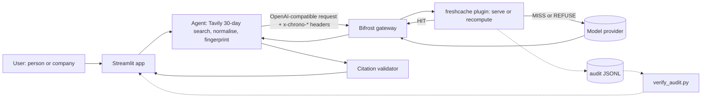

# Architecture

## Header contract
Request, agent to plugin. All are metadata, not authentication.
| Header | Meaning |
|---|---|
| x-chrono-subject | normalised target, max 200 chars |
| x-chrono-intent | `brief` |
| x-chrono-window-days | 30 |
| x-chrono-prompt-version | e.g. brief-v1 |
| x-chrono-newest | newest dated source, RFC3339 UTC, empty if none |
| x-chrono-count-at-newest | dated sources sharing that timestamp |
| x-chrono-dated / x-chrono-undated | counts |
| x-chrono-set-hash | sha256 over sorted (canonical URL, timestamp, title) |
| x-chrono-cache-mode | `normal` or `refresh` (skip lookup, store result) |

Response, plugin to agent: `x-chrono-cache` (HIT, MISS_COLD, REFUSE_*), `x-chrono-cache-key` (first 12 hex), `x-chrono-entry-newest`, `x-chrono-saved-tokens`, `x-chrono-saved-cost-usd`.

## Cache Key & Tenant Isolation (ADR-006)
The cache key is `sha256(len_prefixed(tenant_id, model, subject, intent, window_days, prompt_version))`.
`tenant_id` is extracted inside the Go plugin from the Bifrost virtual key (`x-bf-vk` / Bifrost virtual key context, defaulting to `"default"` only when virtual keys are not configured) and NEVER from a client-supplied `x-chrono-*` header, preventing cross-team cache leakage.
Bumping `prompt_version` invalidates all cached entries deterministically.

## Decision order (internal/decide)
no evidence -> refuse; future-dated -> refuse; no entry -> cold miss; expired -> refuse; newer source -> refuse; undated count changed -> refuse; exact policy and set differs -> refuse; else hit.

## Policy Comparison Benchmark & LLM-Only Savings
- **Canonical Pitch Line**: `"Generate once, reuse when the evidence is unchanged, regenerate when the retrieved facts move."`
- **Savings = LLM cost and tokens only**: Tavily search runs on every request to gather live source timestamps and titles; cache hits save 100% of LLM generation cost and latency.
- **Comparison Benchmark (5-min TTL vs. 24h TTL vs. ChronoBrief freshcache)**:
  - *5-min TTL*: High false-miss rate (recomputes needlessly when teammates prep >5 mins apart with unchanged news).
  - *24h TTL*: High stale-serve rate (serves yesterday's brief after breaking news or headline corrections).
  - *ChronoBrief*: 0% stale serves while retaining full 24h cache hits when evidence is unchanged.

## Audit record (one JSON line per lookup)
ts, key, subject, model, prompt_version, mode, decision, incoming_newest, entry_newest, incoming_count, entry_count, incoming_set_hash8, entry_set_hash8, latency_us, saved_tokens, saved_cost_usd.

## Metrics (computed by scripts/verify_audit.py, never by the plugin)
Hit rate; tokens and cost saved (from the original computation recorded at store time); stale serves (must be 0); stale answers prevented (REFUSE_NEWER_SOURCE count, i.e. what a plain TTL or semantic cache would have served wrongly).

## Threat model, honestly
- `tenant_id` is derived from the Bifrost virtual key context (`x-bf-vk`), never from client headers, guaranteeing cross-tenant cache isolation.
- Freshness headers are client-supplied metadata. A caller who lies about freshness can cause a stale serve. Acceptable here because the only caller is our app; documented, not hidden. Hardening option: shared-secret header checked by the plugin.
- Source text is untrusted. It is fenced as data in the prompt and never treated as instructions.
- A brief that fails citation validation can already be cached by the time we validate it. The client heals this: a HIT that fails validation triggers an immediate `refresh` request.

## Non-goals
No accounts, no database, no scheduled monitoring, no semantic similarity matching. The cache key is exact on purpose.
