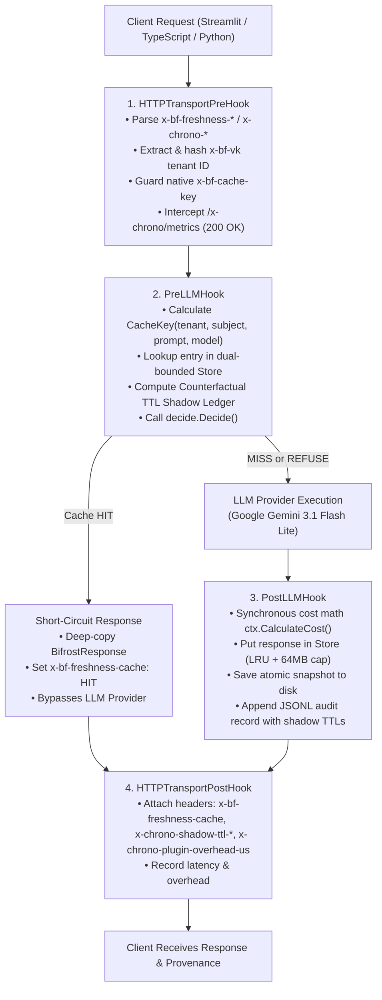

# Bifrost `freshcache` Gateway Subsystem

> **The First Truth-Aware Caching Plugin for the Bifrost AI Gateway**  
> *"Generate once, reuse when the evidence is unchanged, regenerate when the retrieved facts move."*

[](#invariants)
[-blue.svg)](https://github.com/maximhq/bifrost)
[](#measured-performance--benchmarks)
[](#measured-performance--benchmarks)
[-success.svg)](#the-ttl-frontier-simulation-truth-vs-time)

---

## Bifrost Priority Track 04: A Feature the Open-Source Gateway is Missing

Every open-source AI gateway today (including Bifrost, LiteLLM, and Portkey) caches LLM completions by **elapsed time** (e.g. 5-minute TTL, 1-hour TTL, or 24-hour TTL). But business, executive, and financial truth does not expire on a wall clock:

1. **The Short TTL Dilemma (5-minute TTL)**: Causes massive false cache misses. When teammates prepare for the same executive meeting 15 minutes apart, a 5-minute TTL cache re-queries the model needlessly, wasting thousands of tokens and multiplying API latency when nothing in the world changed.
2. **The Long TTL Danger (24-hour TTL)**: Serves stale answers. When breaking news or a financial restatement breaks, a 24-hour TTL cache serves yesterday's outdated brief to executives for hours.
3. **The ChronoBrief Solution**: Caches by **evidence freshness**. Using deterministic cryptographic hashing over sorted canonical source URLs, published dates, and titles, Bifrost serves cached completions only when retrieved facts are unchanged, and regenerates as soon as the retrieved facts move.

---

## The TTL Frontier Simulation: Truth vs. Time

> [!NOTE]
> **Simulation (250 synthetic lookups, assumed news arrivals)**: Queries and news arrival intervals are synthetically generated (`math/rand` seed `20261102`), not recorded production traffic. This simulation illustrates the trade-off between time-based TTL expiration and evidence-based freshness over a 48-hour timeline across 5 tracked companies (see [`docs/evidence/ttl-frontier-report.md`](evidence/ttl-frontier-report.md)).

| Strategy | Cache Decision Rule | Hit Rate | False Misses | Stale Serves | Stale Serve Rate | Tokens Saved | Cost Saved |
|:---|:---|:---:|:---:|:---:|:---:|:---:|:---:|
| **TTL-5m** | Standard 5-minute TTL (short TTL) | **6.4%** | 222 | `0` | **0.0%** | 83,200 | $0.0312 |
| **TTL-1h** | Standard 1-hour TTL | **52.4%** | 107 | `5` | **2.0%** | 681,200 | $0.2555 |
| **TTL-24h** | Standard 24-hour TTL | **96.0%** | 5 | `46` | **18.4%** | 1,248,000 | $0.4680 |
| **`freshcache`** | **ExactSet + 24h ceiling** | **93.2%** | **5** | **`0`** | **0.0%** | **1,211,600** | **$0.4543** |

Chart generated by code from the table (`TestFrontierReportIsUpToDate` fails if the report drifts):

```text
Hit rate (%)
100 |                                                       C
    |D
 80 |
    |
 60 |
    |      B
 40 |
    |
 20 |
    |A
  0 |
    +-------------------------------------------------------------> Stale-serve rate (%)
     0              5             10             15             20

A = TTL-5m     hit   6.4% | stale   0.0% (0) | false misses 222
B = TTL-1h     hit  52.4% | stale   2.0% (5) | false misses 107
C = TTL-24h    hit  96.0% | stale  18.4% (46) | false misses 5
D = freshcache hit  93.2% | stale   0.0% (0) | false misses 5
* = two policies in the same cell
```

---

## Architecture & Bifrost Hook Lifecycle



---

## Measured Performance & Benchmarks

We distinguish strictly between live end-to-end plugin hook latency and isolated Go microbenchmarks (see [`docs/evidence/gateway-benchmarks.txt`](evidence/gateway-benchmarks.txt)):

### 1. Live End-to-End Plugin Hook Overhead (Measured in Docker)
- **HIT: `~2 ms` (median `1.99 ms`, mean `2.35 ms`, min `0.82 ms`, p90 `3.60 ms`, max `7.02 ms`; n=25 live runs in Docker, [`live-overhead-25runs.txt`](evidence/live-overhead-25runs.txt))** (in-memory cache return including HTTP transport hook deserialization).
- **MISS: `~25–35 ms` (median `24.68 ms`, mean `33.26 ms`, min `15.34 ms`, p90 `63.47 ms`, max `86.44 ms`; n=25)** (includes synchronous JSONL audit flush and atomic disk snapshot write `SaveSnapshot`).

### 2. In-Memory Go Microbenchmarks (`go test -bench`, No Disk I/O)
| Subsystem | Benchmark | Metric | Allocations | Notes |
|---|---|---|---|---|
| **Decision Engine** | `BenchmarkDecide` | **`20.17 ns/op`** | `0 B/op` (0 allocs) | Pure deterministic state evaluation (> 51M ops/sec) |
| **Cache Key** | `BenchmarkKeyCompute` | **`306.7 ns/op`** | `160 B/op` (3 allocs) | SHA-256 with length-prefixing |
| **Header Parsing** | `BenchmarkParseHeaders` | **`1.81 µs/op`** | `128 B/op` (2 allocs) | Zero-copy header inspection |
| **LRU Store Hit** | `BenchmarkStoreGetHit` | **`11.36 µs/op`** | `4,991 B/op` (30 allocs) | Full detached JSON deep-copy safety |
| **Native Header Fuzzing** | `FuzzParseHeaders` | **122,383 execs** | 24 workers | 0 panics / 0 crashes over 6 seconds |
| **Race Detector** | `go test -race ./...` | **0 data races** | All packages clean | Verified under CGO |

---

## Universal `x-bf-freshness-*` Contract & Native Cache Guard Mode

Freshcache is completely language-agnostic. Any application can integrate using the universal headers defined in [`gateway/FRESHNESS_CONTRACT.md`](../gateway/FRESHNESS_CONTRACT.md):

### Native Cache Guard Mode (`x-bf-cache-key`)
> [!NOTE]
> **Implementation Status**: Native `x-bf-cache-key` Guard Mode: header stamping/stripping is implemented and unit-tested inside `freshcache`, while end-to-end interaction with Bifrost's built-in `semanticcache` plugin is designed, not yet verified (as `semanticcache` is disabled in `gateway/config.json`).

When callers pass Bifrost's native `x-bf-cache-key`:
- **If evidence is valid**: Freshcache stamps the key with the evidence fingerprint (`x-bf-cache-key: <key>:fc:<newest>:<hash[:8]>`), stamping `x-bf-freshness-guard: STAMPED_SAFE`.
- **If evidence is poisoned/missing**: Freshcache **strips** `x-bf-cache-key`, returning `x-bf-freshness-guard: BYPASSED_UNSAFE` to prevent poisoning Bifrost's internal cache.

### Supported Language SDKs & Multi-Domain Proofs
- **Python**: [`chronobrief/fingerprint.py`](../chronobrief/fingerprint.py)
- **TypeScript / Node.js**: [`gateway/sdk/freshness.ts`](../gateway/sdk/freshness.ts) (Zero-dependency helper using `node:crypto`)
- **Multi-Domain Demo**: [`gateway/examples/sec_8k_guard_demo.py`](../gateway/examples/sec_8k_guard_demo.py) (refuses to reuse a cached answer after a newer SEC 8-K filing arrives).

---

## Operator Readiness & Telemetry

### 1. Live Operator Telemetry Endpoint
Inspect live gateway statistics and Stale-Cache Court counters without touching disk:
```bash
curl -s -X POST -H "x-chrono-admin: metrics" -H "x-bf-vk: test" http://127.0.0.1:8080/v1/chat/completions
```
```json
{
  "status": "healthy",
  "uptime_seconds": 1240,
  "lookups_total": 84,
  "hits_total": 41,
  "stale_prevented_total": 12,
  "court_stale_prevented_ttl_24h": 12,
  "court_stale_prevented_ttl_1h": 3,
  "court_ttl_5m_false_misses": 38,
  "overhead_us_avg": 42.5,
  "overhead_us_max": 180,
  "cache_entries": 14,
  "cache_bytes": 68420,
  "cache_max_bytes": 67108864,
  "snapshot_path": "/var/log/bifrost/freshcache-snapshot.json",
  "snapshot_entries_loaded": 14
}
```

### 2. Atomic Disk Snapshot Persistence (`0600` Permissions)
Cache state is saved atomically to disk with strict `0600` permissions on every store mutation via a temporary file write and atomic rename. When the container restarts:
```bash
docker compose restart gateway
```
Freshcache reloads entries within seconds, immediately serving warm cache `HIT` responses without upstream provider calls.

---

## Security & Threat Model

Detailed in [`docs/SECURITY_AUDIT.md`](SECURITY_AUDIT.md) (All findings F1–F5 closed):

1. **Non-Root Runtime**: Container executes as unprivileged user `uid=100(bifrost)`, `gid=101(bifrost)`.
2. **Fail-Closed ADR-006 Virtual Key Isolation**: Tenant IDs are computed as `sha256(vk)[:12]` strictly from Bifrost's authenticated virtual key context. If the key is missing, caching fails closed (`REFUSE_NO_TENANT`).
3. **No Raw Secrets in Logs**: Virtual keys are hashed before being recorded in `freshcache.jsonl` or cache keys.
4. **Server-Generated Request IDs**: Client-provided `x-request-id` or `x-freshcache-id` headers are ignored to prevent request outcome hijacking.
5. **Strict File Permissions**: All snapshots (`freshcache-snapshot.json`) and audit logs (`freshcache.jsonl`) are enforced with mode `0600`.
